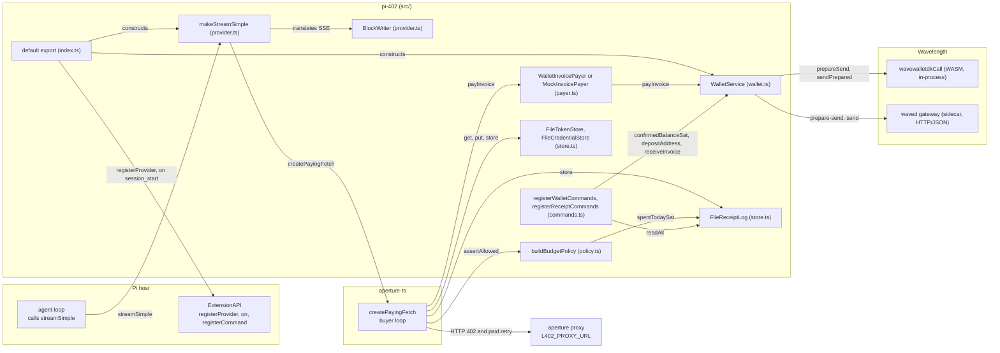
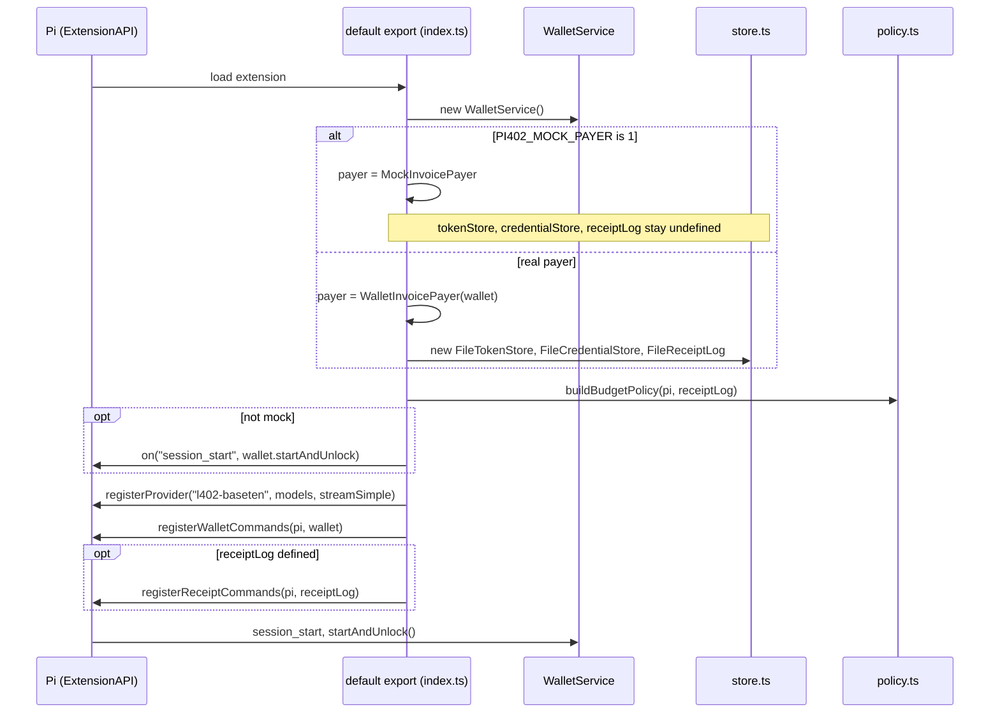
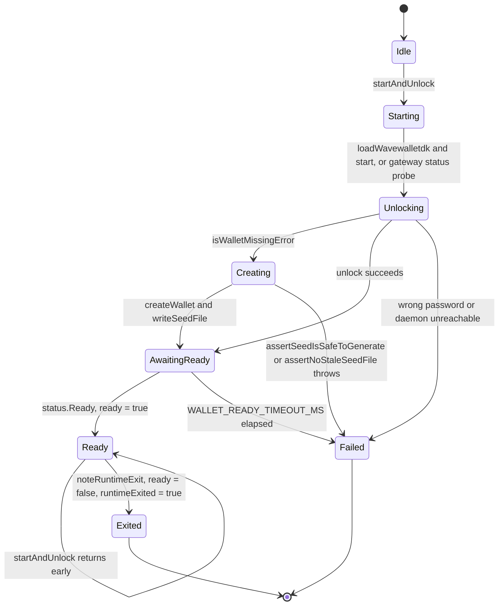
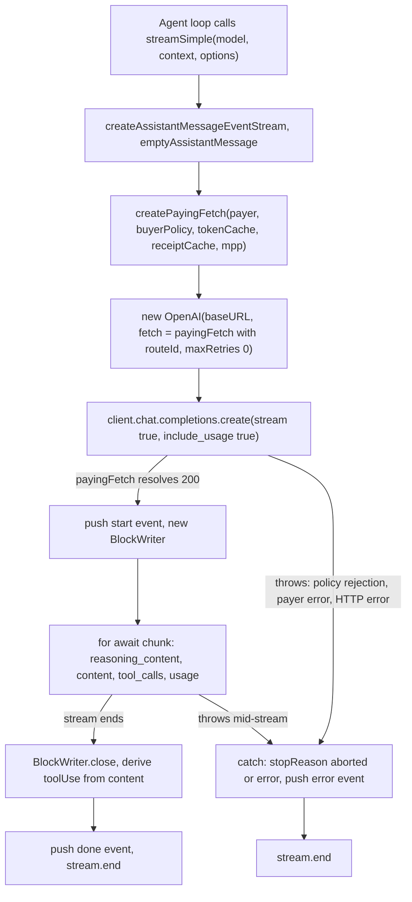
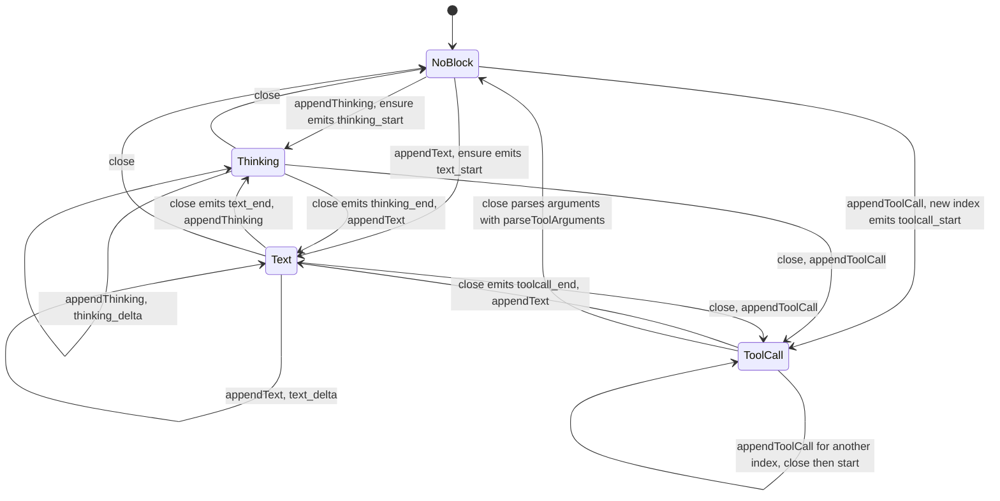
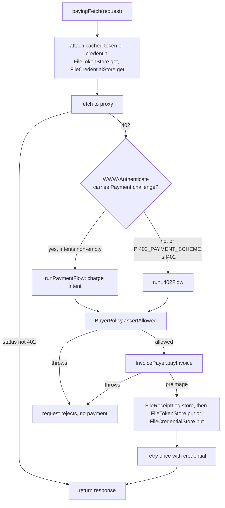
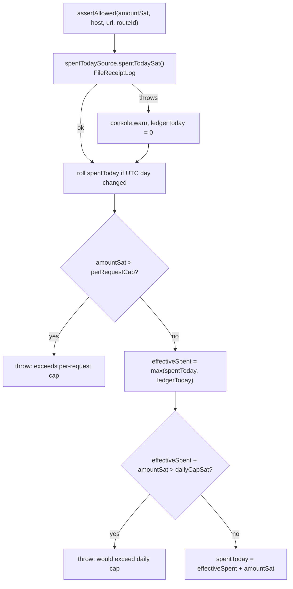
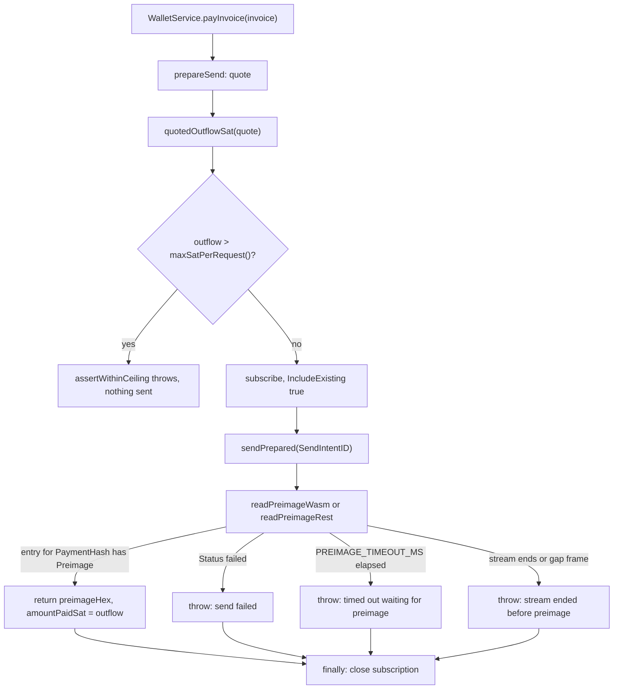
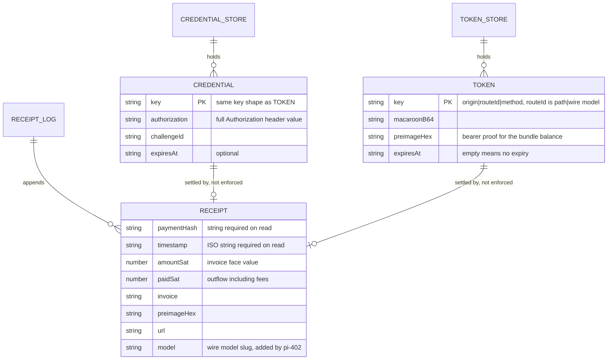

# pi-402 architecture

`pi-402` is a [Pi](https://pi.dev) extension that keeps three things in step:
a model request that Pi wants served, a payment that a seller demands before
serving it, and the local record of what was paid. This document maps the
extension in `src/`: which type owns which state, how a request becomes a
payment and then a streamed reply, and where the extension stops and its
dependencies begin. It describes the tree at commit `79bfe31`. Design
rationale lives in
[`l402-walletdk-inference-payments.md`](l402-walletdk-inference-payments.md)
and
[`l402-protocol-extensions.md`](l402-protocol-extensions.md); this document
does not repeat it.

The extension does not run the payment protocol itself. It builds a paying
`fetch` from `@lightninglabs/aperture-client`, hands it a wallet-backed payer
and a budget policy, and wraps the result in a Pi model provider. The sections
below cover each piece it owns and name the boundary at each dependency.

## Components

The flowchart shows the objects constructed in `src/index.ts` and the calls
between them. The solid edges are runtime calls. Everything inside the
`pi-402 (src/)` subgraph is owned by this repository; the three subgraphs
outside it are dependencies or the seller.

The central object is the paying `fetch` that `makeStreamSimple` builds on every
call. It is not owned by this repository, but all other components exist to
configure it (`policy`, `payer`, the stores) or to consume its results (the
receipt ledger, the stream translation).

| Component | Owns | Does not own |
| --- | --- | --- |
| Default export (`index.ts`) | The provider id `l402-baseten`, the four registered models, the default proxy URL, the choice between mock and real wiring, the `session_start` hook. | Any payment logic, and any Pi internals. |
| `makeStreamSimple` (`provider.ts`) | The mapping from Pi's `Context` to an OpenAI chat request, the mapping from the SSE reply to Pi stream events, the model-id table `BASETEN_MODEL_SLUGS`, the per-model token route (`tokenRouteId`). | The 402 handling, which is inside the paying `fetch`; the wallet. |
| `BlockWriter` (`provider.ts`) | Which content block is open, buffered tool-call argument text, the map from upstream tool-call index to content index. One instance per call. | The `AssistantMessage` lifetime; `makeStreamSimple` creates it. |
| `buildBudgetPolicy` (`policy.ts`) | The per-request ceiling, the daily ceiling, the in-memory daily counter and its UTC day key. Also the scheme and intent selection (`paymentScheme`, `mppIntents`). | The ledger contents (`FileReceiptLog`), and the decision of when to ask (the paying `fetch` calls `assertAllowed`). |
| `WalletInvoicePayer`, `MockInvoicePayer` (`payer.ts`) | Nothing mutable. Both implement `InvoicePayer.payInvoice`. | Any wallet state; the wallet payer forwards to `WalletService`. |
| `WalletService` (`wallet.ts`) | The backend choice (embedded or sidecar), the `ready` and `runtimeExited` flags, wallet creation and unlock, seed backup file, the quote-then-send sequence, the preimage wait. | Keys, swaps, and the Ark and Lightning protocols: those are Wavelength. |
| `FileTokenStore`, `FileCredentialStore` (`store.ts`) | `tokens.json` and `credentials.json`: contents, permissions, merge-on-write, quarantine of corrupt files. | Cache keys and expiry values: the buyer loop chooses them. |
| `FileReceiptLog` (`store.ts`) | `receipts.ndjson`: append, tolerant read, the UTC day sum. | What a receipt contains: `ClientReceipt` comes from the buyer loop; the extension adds `model`. |
| `registerWalletCommands`, `registerReceiptCommands` (`commands.ts`) | The `/wallet`, `/deposit`, `/fund`, `/balance` and `/receipts` handlers, `formatWalletStatus` and `parseFundAmount`. | Any state. Handlers call into `WalletService` and `FileReceiptLog`. |

### What the extension does not own

| Dependency | Owns | Boundary in this repository |
| --- | --- | --- |
| `@lightninglabs/aperture-client` | The buyer loop: detecting a 402, parsing the challenge, choosing between L402 and Payment (MPP), paying at most once per call, retrying exactly once, building cache keys, writing credentials and receipts, MPP session handling. | `createPayingFetch(config)` in `provider.ts`. The extension supplies `payer`, `buyerPolicy`, `tokenCache`, `receiptCache`, and the `mpp` options. |
| `@lightninglabs/aperture-core` | The `InvoicePayer` and `BuyerPolicy` interfaces, and the MPP challenge types. | `payer.ts` and `policy.ts` implement them. |
| Wavelength (`walletdk`) | Keys, the Ark to Lightning swap, quoting, balances, and the activity stream that carries the preimage. | `wallet.ts` only: the `wavewalletdkCall` dispatcher or the gateway's HTTP paths. |
| aperture (the seller) | Challenges, invoice creation, token metering, the model credential, MPP receipts. | The URL in `L402_PROXY_URL`. There is no hosted seller; users run one. |
| Pi | The agent loop, the TUI, model selection, `ctx.ui`. | `ExtensionAPI` and the event types from `@earendil-works/pi-ai`. |

The `aperture-client` behavior described in this document was read from the
installed package's source, not from a pinned specification, and is the
largest area of the document that can drift (see
[Known gaps](#known-gaps)).

## Startup

Everything is registered synchronously when Pi loads the extension. The only
asynchronous step is the wallet bootstrap, which waits for Pi's
`session_start` event.

Two ordering facts matter. First, `buildBudgetPolicy` reads its ceilings from
the environment at construction time, so a malformed `PI402_DAILY_CAP_SAT` or
`PI402_MAX_SAT_PER_REQUEST` throws while Pi is loading the extension, before
any payment is possible. Second, the wallet is not started until
`session_start`, so the provider and commands exist before the wallet does.
A command run before `startAndUnlock` finishes gets the error from
`requireCall` (`wallet not started`); a request that reaches the payer at that
point gets the same error.

In mock mode the three stores are `undefined`, the receipt command is not
registered, and `makeStreamSimple` falls back to an in-memory `TokenCache`.
No file under the data directory is touched.

## Wallet lifecycle

`WalletService` has no explicit state enum; its state is the pair of flags
`ready` and `runtimeExited`, plus whether `gateway` is set. The diagram names
the states those flags imply.

`startAndUnlock` has two backends, selected by `PI402_WALLETD_GATEWAY`:

- **Embedded (default).** `loadWavewalletdk` loads the WASM bundle from
  `PI402_WASM_DIR` or the package's `wasm/` directory and waits for the
  `wavewalletdkCall` global (up to 30 seconds, `waitForGlobal`). The service
  calls `start` with `startConfigFromEnv()`, then `unlockWallet`. On a
  wallet-missing error it calls `createEmbeddedWallet`, then polls the `status`
  verb every `WALLET_READY_POLL_MS` (200 ms) until `Ready`, for at most
  `WALLET_READY_TIMEOUT_MS` (60 000 ms). Unlock returns before the daemon's
  actors are up, which is why `ready` is set only after this poll.
- **Sidecar.** When the gateway variable is set, the service probes
  `/v1/wallet/status`, unlocks via `/v1/wallet/unlock` when needed, and creates
  via `/v1/wallet/create` only if unlock failed because no wallet exists. It
  sets `ready` immediately and does not poll.

In both backends the create path is entered only when `isWalletMissingError`
matches. A wrong password or an unreachable daemon rethrows, so it cannot cause
a second wallet to be created. In the embedded backend, `createEmbeddedWallet`
either restores `PI402_WALLET_MNEMONIC` (with `RecoverState` and
`RecoveryWindow` set to `WALLET_RECOVERY_WINDOW`, 100) or generates a seed and
writes it once to `seed.txt` under the wallet directory. Generation is refused
on mainnet unless allowed explicitly, and refused when a stale `seed.txt`
already exists. If the seed file write fails after the wallet was created, the
thrown error tells the operator to delete the still-empty wallet directory.

`noteRuntimeExit` is the only transition out of `Ready`. It is called when the
embedded Go runtime stops. After it, `requireCall` throws on every call, so
callers fail immediately instead of waiting on a dispatcher nothing answers.
The sidecar backend has no equivalent: a dead gateway surfaces as a `fetch`
error on the next call.

## The request pipeline

A Pi turn becomes one `streamSimple` call, which becomes one HTTP request to
the proxy and one stream of Pi events. `streamSimple` returns the event stream
at once and fills it from an async function.

1. **Build the output.** `makeStreamSimple` creates the event stream and
   `emptyAssistantMessage`. The returned stream is handed to Pi before any
   network activity.
2. **Build the paying fetch.** A `createPayingFetch` instance is created inside
   each call. The long-lived pieces are not: `tokenCache` is created once per
   provider (`deps.tokenStore ?? new TokenCache()`) and the stores, policy and
   payer are shared. The per-call `receiptCache` adapter stamps each receipt
   with `wireModelId(model.id)` before `FileReceiptLog.store`.
3. **Scope the token to the model.** The OpenAI client's `fetch` calls
   `payingFetch(input, { ...init, routeId: tokenRouteId(input, wireModel) })`.
   The buyer loop keys its caches on `origin|routeId|method`, and every model
   posts to the same `/v1/chat/completions` path, so the route id is
   `<path>|<wire model>`. Without it, paying for one model would overwrite the
   token of another and strand the first bundle's unspent balance.
4. **Disable SDK retries.** `maxRetries: 0` keeps the OpenAI SDK from
   re-entering `payingFetch` after a throw. A throw after a payment was
   dispatched, such as a preimage timeout, would otherwise fetch a fresh 402
   and pay a second time. The buyer loop is the only place a retry happens.
5. **Send the request.** `toOpenAiMessages` and `toOpenAiTools` project Pi's
   context. `max_tokens` is `options.maxTokens`, or
   `Math.floor(model.maxTokens / 3)` when unset. `stream_options.include_usage`
   is `true`, because the seller debits from the final chunk's usage.
6. **Translate the stream.** Each chunk is fed to `BlockWriter`: thinking
   from `reasoning_content`, text from `content`, tool calls from
   `tool_calls`. `finish_reason` `length` and `tool_calls` set the stop reason.
   The last `usage` object wins.
7. **Finish.** `BlockWriter.close` closes the open block. If any `toolCall`
   block exists but `finish_reason` did not say so, the stop reason is forced to
   `toolUse`, because Pi routes on the stop reason. The `done` event and
   `stream.end` follow.
8. **Fail.** Any throw in steps 3 to 7 lands in one `catch`: the stop reason
   is `aborted` when `options.signal` was aborted and `error` otherwise, and
   the message comes from `error.cause` when present. The OpenAI SDK wraps
   transport throws, including budget rejections, in a generic connection error
   whose `cause` holds the real message.

### Stream translation states

`BlockWriter` enforces Pi's bracketed protocol: every content block is opened,
filled and closed, and event indices address the right block.

Tool-call arguments arrive as JSON fragments. `BlockWriter` buffers them in
`rawArguments` and parses them once, in `close`, with `parseToolArguments`.
Unparseable or empty arguments become `{}` (with a `console.warn` in the
unparseable case), so the tool rejects the call rather than the stream
failing. A fragment for a call that was interrupted by another block reopens
that call's block through `toolIndexToContent`; in that case the
`toolcall_start` event is not emitted a second time.

## The payment pipeline

The extension never sees a 402 directly. The paying `fetch` receives it, and
calls back into three pieces the extension supplied: the policy, the payer, and
the stores. The flowchart shows the L402 path and the MPP charge path as
`aperture-client` runs them, with the extension's callbacks named.

1. **Look up.** The buyer loop builds the key `origin|routeId|method` and asks
   the stores for a credential. A hit is attached to the first request. A
   cached credential that the server answers with a 402 is deleted from
   `FileCredentialStore` before the challenge is handled.
2. **Choose a scheme.** When the 402 carries a Payment challenge and the
   `mpp.intents` list is non-empty, the loop runs the Payment flow. An empty
   list (`PI402_PAYMENT_SCHEME=l402`, from `mppIntents`) makes the loop decline
   the Payment offer and use the L402 challenge in the same header. Otherwise
   the L402 flow runs.
3. **Assert the budget.** `assertAllowed` runs before any wallet action, on the
   amount the seller stated. See [Budget policy](#budget-policy).
4. **Pay.** `WalletInvoicePayer.payInvoice` forwards to
   `WalletService.payInvoice`, which re-checks the per-request ceiling against
   the quoted total outflow. See [Paying an invoice](#paying-an-invoice).
5. **Record, then retry.** The receipt is written first, then the token or
   credential is stored, then the request is retried once. The receipt is
   therefore on disk even if the retry throws. Whatever the retry returns goes
   to the caller, including a second 402.

### MPP charge and session handling

The extension decides which MPP intents the buyer may take; the intent flows are
implemented in `aperture-client`.

- **Charge** is the default: `mppIntents()` returns `["charge"]` when
  `PI402_MPP_INTENTS` is unset and the scheme is not `l402`. A charge settles
  one request with one invoice and leaves nothing outstanding.
- **Session** requires a return-invoice minter, an object with
  `mintAmountlessInvoice`, because the deposit's refund needs an amountless
  invoice. The embedded wallet cannot mint one, so `index.ts` never sets
  `returnInvoiceMinter`. `mppIntents` throws if `PI402_MPP_INTENTS` includes
  `session` without a minter, so a deposit is never paid for an open the
  server would refuse. The development harness (`dev/l402-e2e.ts`) passes a
  minter and so can exercise sessions on regtest.
- **Credentials.** `FileCredentialStore` is passed as `mpp.credentialCache`. It
  keeps the `Authorization` header of a settled charge so that a retry that
  throws after payment does not buy the same thing twice.
- **Receipt mismatch.** `onReceiptMismatch` logs a `console.warn` with the
  receipt reference and the reasons. It does not reject the response.

`paymentScheme()` accepts `auto` or `l402` and throws on any other value, so a
typo cannot change the protocol the money moves over. `mppIntents()` likewise
rejects entries other than `charge` and `session`.

## Budget policy

`buildBudgetPolicy` returns a `BuyerPolicy` with one method, `assertAllowed`.
There are two checks, one per ceiling, and one counter.

The defaults are `DEFAULT_MAX_SAT_PER_REQUEST` (1 000 sat) and
`DEFAULT_DAILY_CAP_SAT` (100 000 sat). `readSatCeiling` rejects a set but
non-positive or non-numeric value, because `Number("1,000")` is `NaN` and every
comparison with `NaN` is false, which would let all spending through.

- **Two counters.** The in-memory `spentToday` carries amounts that are
  asserted but not yet settled, and quotes for payments that later failed. The
  ledger carries settled spends from other sessions. `Math.max` of the two is
  conservative against either gap.
- **No rollback.** The counter is incremented in `assertAllowed`, before the
  wallet pays. The buyer loop offers no post-payment hook, so a failed payment
  keeps consuming the daily budget until the next UTC day.
- **Unreadable ledger.** A throw from `spentTodaySat` is logged and treated as
  zero spend, so the daily cap falls back to the in-memory counter alone.
- **Synchronous section.** After the ledger read, the check and counter update
  contain no `await`, so concurrent assertions in one process cannot interleave
  between the check and the update.
- **Cross-process bound.** Spends asserted but not yet in the ledger in other
  processes are not visible. The overshoot is bounded by the sum of those
  processes' in-flight amounts, each at most the per-request cap.

The policy runs on the seller's stated `amountSat`. The wallet runs its own
check afterwards on the real cost, covered next.

## Paying an invoice

`WalletService.payInvoice` is the only code that moves funds. It implements the
two-phase send of Wavelength with a second budget check between the phases.

1. **Quote.** `prepareSend` returns the invoice amount and the swap fee.
   `quotedOutflowSat` accepts snake_case (gateway) or PascalCase (WASM) keys,
   and prefers an explicit total-outflow field over principal plus fee.
2. **Check.** `assertWithinCeiling` compares the quoted total outflow to
   `maxSatPerRequest()`. This is the check that sees the fee and the invoice's
   encoded amount; the policy earlier saw only the seller's stated amount.
3. **Subscribe first.** The activity stream is opened before `sendPrepared`.
   Subscribing afterwards would depend on `IncludeExisting` replaying a settle,
   and a missed settle would surface as a timeout.
4. **Send and wait.** The wait ends on the first entry whose payment hash
   matches and which carries a preimage. `PREIMAGE_TIMEOUT_MS` is 120 000 ms.
   The returned `amountPaidSat` is the quoted outflow, which the buyer loop
   records as `paidSat`.
5. **Close.** A `finally` block closes the subscription on every path.

A timeout or a failed send does not mean no money moved: the send was already
dispatched. The extension has no refund or reconciliation logic. The buyer loop
does not retry after the throw, and the OpenAI SDK retries are disabled (see
[The request pipeline](#the-request-pipeline)), so the failure surfaces to Pi as
an error event.

`MockInvoicePayer` skips all of this: it returns a fixed 32-byte zero preimage
and the stated amount.

## Storage

All durable state is under `dataDir()`: `PI402_DATA_DIR`, or `~/.pi402`. The
wallet's own databases and `seed.txt` are under `wallet/` in the same directory
(or `PI402_WALLET_DIR`). Sessions share the files, so every operation reads
fresh.

| File | Class | Format | Write method | Read failure behavior |
| --- | --- | --- | --- | --- |
| `tokens.json` | `FileTokenStore` | One JSON object, `version: 1`, map of tokens | Read, merge, write to a unique tmp file with mode `0o600`, `rename` over the target | Missing: empty. Corrupt: renamed to `*.corrupt`, empty. Other error: `get` returns `null`, `put` throws. |
| `credentials.json` | `FileCredentialStore` | One JSON object, `version: 1`, map of credentials | Same as tokens; `delete` shares the rewrite | Same as tokens; `delete` on an unreadable store logs and returns. |
| `receipts.ndjson` | `FileReceiptLog` | One JSON receipt per line | `appendFile` of one line, then `chmod 0o600` | Missing: empty. A trailing partial line and lines without a string `paymentHash` and `timestamp` are skipped. |

The data directory is created with mode `0o700` on first write. All three files
hold bearer material (a macaroon and preimage, an `Authorization` header, or
preimages and invoices), which is why they are owner-only.

The three files have no foreign keys. A token or credential and the receipt for
the payment that bought it are written by the same payment, in that order, but
nothing links them: the receipt is an audit record and the daily cap's ground
truth, and the token files are caches that expire and are rewritten.

- **Expiry.** An empty `expiresAt` never expires. A non-empty value that does
  not parse counts as expired, so that malformed input is never an immortal
  bearer credential. Expired entries are dropped on every read, so `put` also
  prunes.
- **Merge-on-write.** `put` re-reads the file so another session's token
  survives. The read-merge-write is not atomic across processes, nor across
  concurrent puts in one process. Two writes in the same instant can lose one
  entry; the cost is re-buying one bundle or request.
- **Read errors propagate in `put`.** `readState` rethrows any error except
  `ENOENT`. A transient failure on an intact file must not cause `put` to
  rewrite the file down to a single entry.
- **Receipt amounts.** `receiptPaidSat` uses `paidSat` when it is a finite
  positive number, then `amountSat`, then zero. A `NaN` or negative value in a
  shared file would otherwise corrupt or erode the daily total.
- **Day boundary.** `spentTodaySat` and `/receipts` both compare the first 10
  characters of the ISO timestamp, which is the UTC date.

## Slash commands

The commands are registered on `ExtensionAPI.registerCommand`. They run out of
band from inference, and the agent never sees their output.

| Command | Handler calls | Output |
| --- | --- | --- |
| `/wallet` | `WalletService.status` | Status line `pi-402` with the spendable balance, and a notification with the network, spendable, arriving and outgoing sats, plus a hint when the wallet is still syncing, empty, or has a deposit arriving. |
| `/balance` | `WalletService.confirmedBalanceSat` | A notification with the balance. |
| `/deposit` | `WalletService.depositAddress` | An on-chain boarding address. |
| `/fund <sats>` | `parseFundAmount`, `WalletService.receiveInvoice` | A Lightning invoice. Rejects a missing or non-positive whole number; strips `_` and `,`. |
| `/receipts` | `FileReceiptLog.readAll` | The count, the all-time total, today's total, and the last 10 receipts, newest first, with the first 12 characters of each payment hash. |

`/receipts` is registered only when `receiptLog` exists, so it is absent in
mock mode. The other four are always registered, and in mock mode they fail
with `wallet not started` because the wallet is never started.

## Concurrency

The extension runs on one JavaScript event loop. Its concurrency is
interleaving at `await` points inside Pi's process, plus other `pi` processes
sharing the data directory.

| Context | Touches | Rule |
| --- | --- | --- |
| Each `streamSimple` call (async IIFE) | Its own `output`, `BlockWriter`, OpenAI client and paying `fetch`. | No shared mutable state except through the shared objects below. |
| Shared `tokenCache` (one per provider) | `tokens.json` through `FileTokenStore`. | Each call reads and writes fresh; no in-process cache. |
| Shared policy closure | `spentToday`, `currentDay`. | Updated only in the synchronous tail of `assertAllowed`. |
| `WalletService` | `ready`, `runtimeExited`, `call`, `gateway`. | `startAndUnlock` is called once from `session_start`. A second call returns early when `ready`; it is not guarded against overlapping calls while starting. |
| Preimage wait | One `setTimeout` per wait, cleared in `finally`. | The timer sets `timedOut` and closes the subscription; it posts no other message. |
| Other `pi` processes | The three files. | Reads are fresh, token and credential writes are tmp-and-rename, ledger writes are single-line appends. |

Rules a caller can get wrong:

- **Parallel calls can both pay.** Nothing in the extension serializes
  `streamSimple` calls. Two concurrent calls for the same model with no cached
  token can each receive a 402 and each pay (inferred from the code, not
  tested). The policy's synchronous section keeps the daily accounting correct
  in that case.
- **A timeout is not a refund.** `PREIMAGE_TIMEOUT_MS` expiring means the
  preimage was not seen in time. The send may still settle later, and the
  token that payment bought is not stored, because the buyer loop never got the
  preimage.
- **Abort does not cancel a payment.** `options.signal` aborts the OpenAI
  request. A `payInvoice` already past `sendPrepared` is not cancelled by it.
- **The daily counter outlives failures.** See [Budget policy](#budget-policy).

## Known gaps

- **Buyer loop internals.** The description of `createPayingFetch` (ordering of
  receipt write, token store and retry; the delete of a refused cached
  credential; the Payment-then-L402 fallthrough) was read from the source of
  the `aperture-client` package installed in `node_modules` and may differ from
  the version a user installs. The extension's own tests do not cover it.
- **MPP flows.** Charge and session behavior beyond the options passed from
  `provider.ts` and `policy.ts` is not described. Session flows are exercised
  only by the development harness.
- **Wallet behavior at runtime.** The behavior of `prepareSend`,
  `sendPrepared` and the activity stream is taken from the call sites in
  `wallet.ts` and its comments. Nothing here was run against a live wallet.
- **Sidecar mode.** The gateway paths and frame shapes (`preimageFromFrame`,
  `NdjsonFramer`) are described from the code; the default gateway address is
  not stated because the code does not set one.
- **Skipped.** The WASM loader internals (`loadWavewalletdk`, SQLite bridge
  setup), `startConfigFromEnv` network options beyond the regtest defaults, the
  `dev/` harnesses, and the `talk/` material are not covered.
